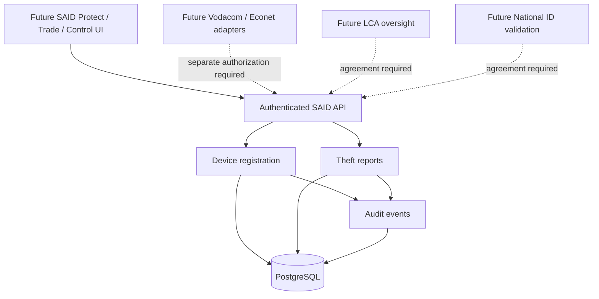

# SAID architecture (Phase 1)

**Product:** SAID — Secure Asset Identity & Detection — an Ithute Digital Solutions product.

## Boundary

SAID does not install firmware, change device operating systems, modify bootloaders, or possess network-level blocking capabilities by itself.

## Phase 1 security boundary

All data endpoints are *admin-only* with a strong development API key; anonymous users cannot register devices. This is NOT sufficient for a live service. Prior to external deployment replace this credential with user and institutional identities, MFA, RBAC/ABAC, legal-basis enforcement and per-owner authorization. Use TLS at the reverse proxy, configure secrets externally, and apply database migrations before production.

The database stores an opaque owner reference, *not* a verified National ID. New devices are unverified; theft reports are pending review. No blacklisting is performed.

## Fraud detection principles

A changed IMEI cannot be predicted deterministically. Correlation may consider lawful operator IMEI/IMSI history and supporting evidence, with human review, false-positive controls and appeal rights. SIM changes are not proof of theft.
